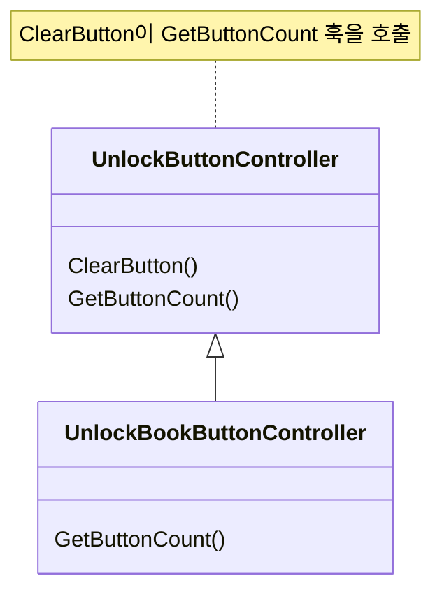
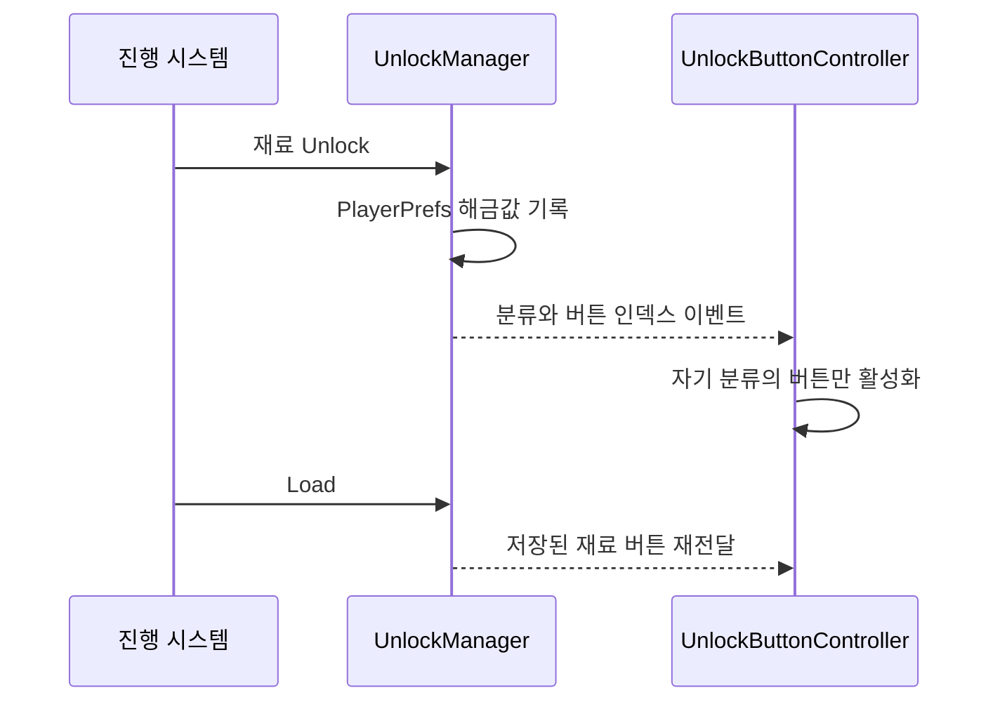

# 재료 해금 이벤트와 UI 갱신

**담당자:** 최성원 — 재료·레시피 해금, 최초 발견 시 해금 호출, 업적 상태 저장과 해금 UI 구현

## 코드

**Observer:** 해금 이벤트와 UI 수신자를 분리합니다. **Template Method:** ClearButton의 공통 순회는 유지하고, GetButtonCount 훅만 레시피북에서 재정의합니다. 두 구조 모두 원본에 있습니다.





**GameManager:** 날짜 진행에 따라 해금을 요청합니다. **UnlockManager:** 해금 상태를 기록하고 분류·버튼 인덱스를 알립니다. **UnlockButtonController / UnlockBookButtonController:** 공통 이벤트를 받아 각 화면의 버튼을 갱신합니다. **AchievementManager:** 업적 중복 해금 방지와 알림을 담당합니다.

```csharp
// GameManager.nextCustomer: 날짜 증가 직후 실행하는 분기 중 하나
private void UnlockIngredientForDay()
{
    if (day == 2)
        UnlockManager.instance.Unlock(Ingredient.MeatFish.chicken);
}

// UnlockManager: 같은 구조의 네 오버로드 중 MeatFish를 대표로 발췌
public static event Action<int, int> ButtonUnlockAction;
public event Action OnUnlockAction;
public static event Action ClearAction;

public void Unlock(Ingredient.MeatFish meatFish)
{
    PlayerPrefs.SetInt(meatFish.ToString(), 1);
    // enum의 noCondition(0)은 버튼이 아니므로 UI 인덱스에서 제외
    // 두 번째 인자 2는 MeatFish 분류이며, 각 UI가 자기 분류인지 확인한다.
    ButtonUnlockAction?.Invoke((int)meatFish - 1, 2);
    // 이 이벤트는 Unlock 호출마다 전달되며 최초 해금만 보장하는 검사는 없다.
    OnUnlockAction?.Invoke();
}

// 이미 저장된 해금 상태를 UI에 재전달하는 Load의 MeatFish 부분
public void LoadMeatFishButtons()
{
    foreach (Ingredient.MeatFish item in Enum.GetValues(typeof(Ingredient.MeatFish)))
    {
        if (IsUnlocked(item))
            ButtonUnlockAction?.Invoke((int)item - 1, 2);
    }
}

// 기록이 없는 재료는 기본값 0으로 읽어 잠금 상태로 처리한다.
public bool IsUnlocked<T>(T item)
{
    return PlayerPrefs.GetInt(item.ToString(), 0) == 1;
}
```

```csharp
// UnlockButtonController: 해금 관리자는 구체적인 UI 오브젝트를 알 필요가 없음
private void Awake()
{
    UnlockManager.ButtonUnlockAction += UnlockButton;
    UnlockManager.ClearAction += ClearButton;
}

// 분류가 일치하는 패널만 해당 재료 버튼을 활성화
public void UnlockButton(int childIndex, int category)
{
    if ((int)mode != category) return;
    transform.GetChild(childIndex).gameObject.SetActive(true);
}

// 초기화 이벤트를 받으면 재료 버튼만 숨김
public void ClearButton()
{
    for (int i = 0; i < GetButtonCount(); i++)
        transform.GetChild(i).gameObject.SetActive(false);
}

// 조리 화면의 끝에 배치된 진행 버튼은 초기화 대상에서 제외
protected virtual int GetButtonCount()
{
    return mode switch
    {
        Mode.Base => transform.childCount - 1,
        Mode.Cook => transform.childCount - 2,
        _ => transform.childCount
    };
}

// 정적 이벤트가 파괴된 UI를 계속 참조하지 않도록 구독을 해제한다.
private void OnDestroy()
{
    UnlockManager.ButtonUnlockAction -= UnlockButton;
    UnlockManager.ClearAction -= ClearButton;
}
```

```csharp
// UnlockBookButtonController: 레시피북은 자식 전체가 재료 버튼
public class UnlockBookButtonController : UnlockButtonController
{
    protected override int GetButtonCount() => transform.childCount;
}

// AchievementManager: 업적 상태를 먼저 확인해 중복 알림 방지
public void AchievementUnlock(Achievements achievement)
{
    if (PlayerPrefs.GetInt(achievement.ToString(), 0) == 1) return;

    PlayerPrefs.SetInt(achievement.ToString(), 1);
    PlayerPrefs.Save();
    achievementUItext.text = achievementList[(int)achievement].achievementTitle;
    achievementUI.PopInAndOut();
}
```

**CookManager 기여 범위:** 요리 진행·평판 계산은 팀원 구현입니다. 그 내부에서 최성원이 추가한 최초 발견 시 해금 호출만 아래에 발췌했습니다.

```csharp
// CookManager.judge의 해금 호출만 설명용 메서드로 분리
private void UnlockFirstRecipe(RecipeData food)
{
    if (!UnlockManager.instance.IsRecipeUnlocked(food.recipeName))
        UnlockManager.instance.UnlockRecipe(food.recipeName);
}
```

## 생략 및 재구성한 내용

- UnlockFirstRecipe는 기여한 두 줄을 분리한 설명용 함수명입니다. 원본의 요리·평판 판정 전체를 개인 기여로 제시하지 않습니다.
- 원본: `Assets/Scenes/Scripts/`의 GameManager·UnlockManager·AchievementManager·CookManager와 `UI/UnlockButtonController.cs`, `UI/UnlockBookButtonController.cs`. 기준 커밋: `87c7ce2f89e529301e5f32d91fe2c6c5155ddaac`.
- GameManager.nextCustomer의 날짜별 분기를 설명용 UnlockIngredientForDay로, UnlockManager.Load의 분류별 반복을 LoadMeatFishButtons로 분리했습니다. 새 함수명은 발췌용이며 원본에 그대로 존재하지 않습니다.
- 이벤트의 두 번째 인자는 Base=0, Cook=1, MeatFish=2, Vege=3입니다. 다른 분류의 동일한 Unlock·Load 반복과 초기 해금 목록은 생략했습니다. 
- 초기화는 원본 ResetData에서 PlayerPrefs.DeleteAll → ClearAction → 기본 재료 해금 순서입니다. 프로젝트 전체 저장값을 삭제하므로 범용 저장 초기화 예제로 제시하지 않고 본문에서는 생략했습니다.
- 업적별 누적 횟수와 조건, 싱글턴 수명 관리·필드·enum 선언은 생략했습니다. 코드 블록은 여러 클래스의 발췌로 단독 실행되지 않으며, UI 자식 순서와 참조는 원본 씬에 의존합니다.
- 사용자가 언급한 UnlockBookController의 실제 파일명은 UnlockBookButtonController입니다.
